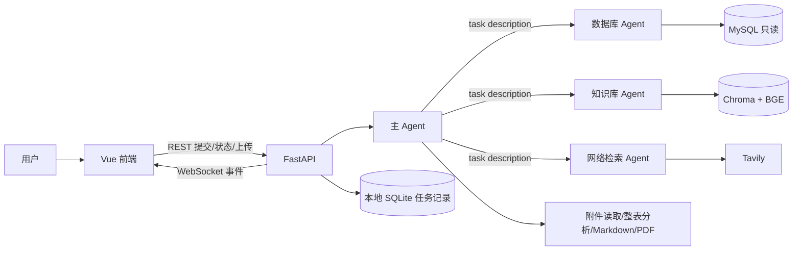

# 数据分析助手

一个可在本机运行的多 Agent 数据分析原型：主 Agent 使用 DeepAgents 调度数据库、内部知识库和网络检索三个子 Agent；也可直接分析上传附件并生成 Markdown/PDF。前端是 Vue 3，后端是 FastAPI，任务状态通过 WebSocket 推送并保存在本地 SQLite。

## 架构



子 Agent 通过 DeepAgents 的 `task(subagent_type, description)` 调用；它们的最终答复作为工具消息返回主 Agent。附件清单、表格分析和报告生成由主 Agent 直接使用。简单药品清单有一条本地只读查询快捷路径。

## 快速启动（Windows PowerShell）

需 Python 3.12、Node.js、MySQL。PDF 转换依赖 Windows Word；其他功能可单独使用。把 `.env.example` 复制为 `.env`，填写自己的 DeepSeek、MySQL、Tavily 配置。不要提交 `.env`。

```powershell
py -3.12 -m venv .venv
.\.venv\Scripts\python.exe -m pip install -e .
Copy-Item .env.example .env
# 编辑 .env 后，启动后端：
.\.venv\Scripts\python.exe -m uvicorn api.server:app --host 127.0.0.1 --port 8000
```

另开 PowerShell：

```powershell
cd frontend
npm install
npm run dev
```

开发环境由 Vite 代理 `/api` 和 `/ws` 到后端。若自行更换端口，请同步调整 `frontend/vite.config.js` 或设置对应环境变量。将自己的非敏感资料放入 `knowledge_base/` 后，按 `scripts/build_knowledge_base.py` 建立内部知识库索引；该目录及本地模型缓存不会上传到仓库。MySQL 建表见 `sql/init.sql`；已有旧库可参考 `sql/001_add_drug_class.sql` 升级分类字段，应用账号保持只读。

## 五分钟演示

1. 运行 `.\.venv\Scripts\python.exe scripts\make_demo_data.py`，得到 `demo/weekly_sales_demo.xlsx` 和一条带准确日期的演示问题。
2. 在页面底部选这个 Excel 文件，粘贴脚本打印的问题并提交。说明工作表是“销售明细”，另一页只是说明。
3. 展示实时执行事件、生成的 Markdown 文档和右侧可调整高度的预览区。
4. 对照原始表核对：指定周 6 笔，总额 210；阿莫西林 90，布洛芬 120；下一周 999 不计入。若结论不符，应在演示中如实指出。
5. 打开同一会话查看文件；刷新页面验证历史恢复。取消功能可用另一个任务演示，运行前说明这会产生真实模型调用。

这份 Excel 是合成数据。运行页面上的问答会把任务说明及工具返回的必要内容发送给所配置的模型服务；使用自己的测试配置和非敏感数据演示。

## 评测与测试

```powershell
.\.venv\Scripts\python.exe scripts\eval_agent.py --output eval\results\latest.json
.\.venv\Scripts\python.exe -m unittest discover -s tests -q
cd frontend
npm test
npm run build
```

`eval/agent_cases.json` 固定了 30 条本地用例，覆盖日期范围、否定筛选、多工作表、统计、分页、坏值和路径边界。脚本为每条记录成功与否、耗时并计算 P50/P95。已保存的 [基线结果](eval/results/local_2026-10-24.json) 是 **30/30 工具契约用例通过**；它没有调用 LLM，因此 `llm_accuracy`、`llm_latency_ms`、`llm_cost_usd` 均记为 `null`。不能将这个结果称为 Agent 问答正确率、线上延迟或模型成本。自动化测试还包括本地假模型调用真实 DeepAgents 执行图的用例。

真实模型评测需要固定模型版本、同一套任务与数据、记录调用轨迹和用量，并对最终答案做人工或可计算的判定。当前还没有可发布的真实模型准确率或速度改善数据。

## 当前边界

- 演示 MySQL 销售记录是 2025 年的旧数据；查询当前周时应给出无数据说明，或上传当前销售表。
- 正式药品分类字段需有权限账号运行迁移；旧数据库结果明确标为按治疗领域推断。
- 表格工具对全表做筛选和汇总，最多读取 25 MB / 20 万行；暂不支持跨文件关联、任意计算列或 OR 条件。
- 扫描 PDF 尚无 OCR；PDF 生成依赖 Windows Word。
- 任务历史保存在本机 `output/.history/tasks.sqlite3`；该原型尚无用户鉴权、多人隔离或生产部署配置。
- 主 Agent 的两轮纠错和可选复核不保证最终事实正确；关键业务指标仍须对照源数据核验。
